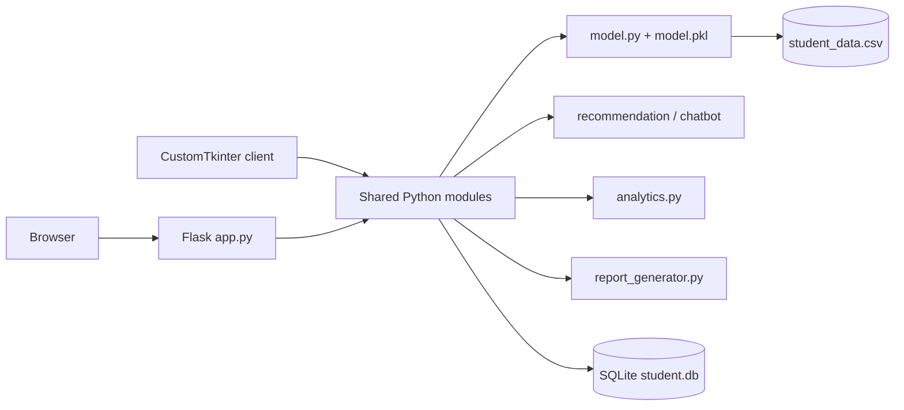
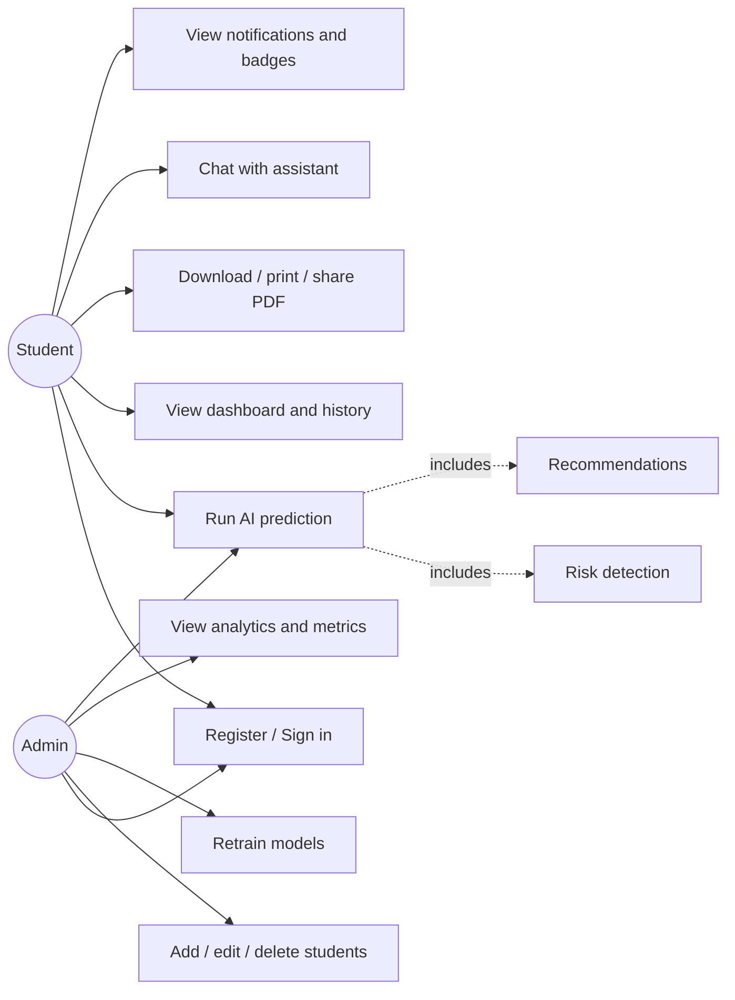
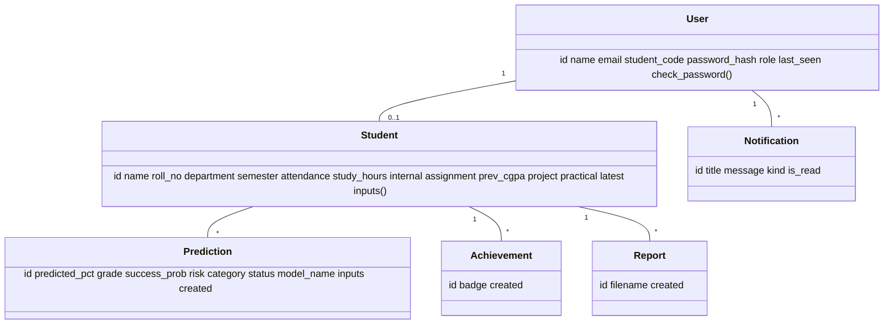
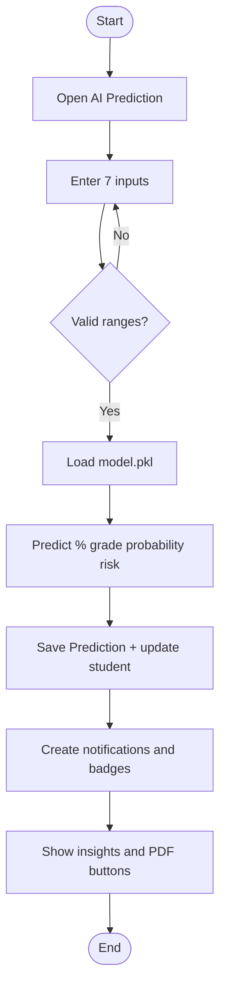
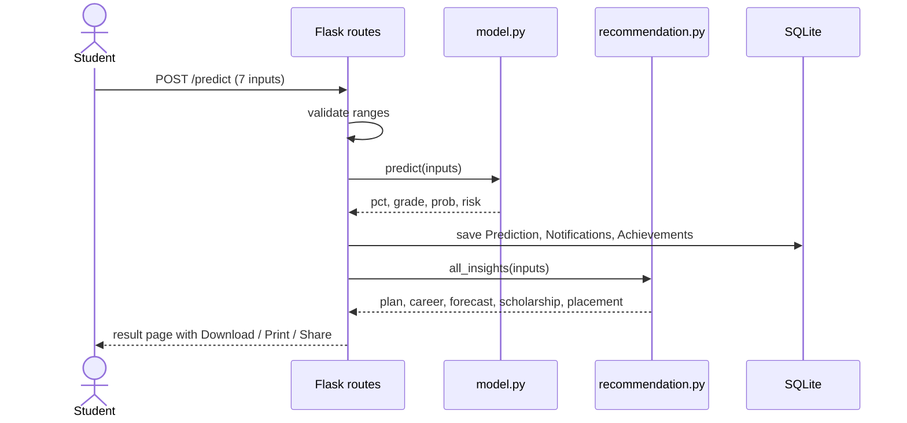
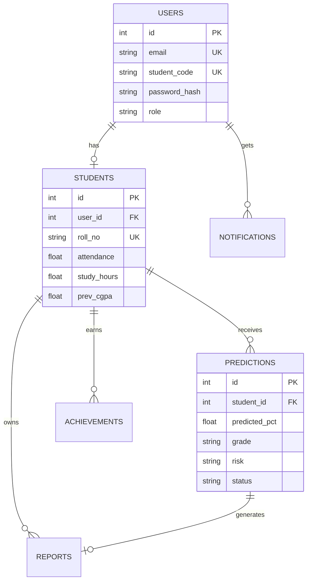
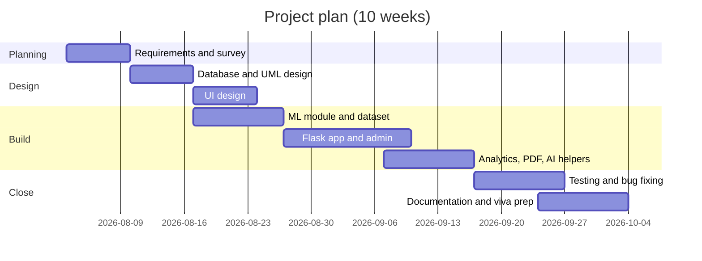

# AI-Powered Student Performance Prediction and Academic Analytics System
*Mini Project Report*

## 1. Abstract
Colleges usually discover that a student is struggling only after the results are published. This project builds a web and desktop system that predicts a student's final percentage, grade, pass probability and risk level from attendance, study hours, internal, assignment, project and practical marks and previous CGPA. Four regression models (Linear Regression, Decision Tree, Random Forest, Gradient Boosting) are trained and compared, and the most accurate is saved with Joblib and used for live predictions. Around the model sit an analytics dashboard, PDF reports, early-warning notifications, achievement badges, a leaderboard, an admin panel and ten rule-based AI helpers (study plan, career, scholarship, placement and others).

## 2. Introduction
Academic performance depends on measurable habits: how often a student attends, how long they study and how they score in continuous assessment. Machine learning can learn the relationship between these inputs and the final result from past records. The system turns that into actions: alerts for staff, a plan for the student and a printable report.

## 3. Objectives
1. Predict final percentage, grade, pass probability and risk for any student.
2. Compare four ML models and select the best automatically.
3. Give students personalised guidance; give admins institution-level analytics.
4. Provide secure login for students and administrators.
5. Export professional PDF reports with a verification QR code.

## 4. Scope
In scope: student and admin portals, CRUD on student records, model training window, eight interactive charts, PDF export, notifications, badges, chatbot. Out of scope: integration with a real university ERP, live attendance capture, multi-college tenancy.

## 5. Advantages
- Early identification of at-risk students (before exams).
- One system for prediction, analytics, reporting and guidance.
- Transparent: metrics, feature importance and the selected model are visible.
- Runs on a laptop with only Python and SQLite.

## 6. Limitations
- The bundled dataset is synthetic; accuracy on real data must be re-measured after retraining.
- Predictions are estimates and do not replace official results.
- Forms have no CSRF protection and the secret key is a development default; harden both before any public deployment.
- Career, scholarship and placement outputs are rule-based, not learned.
- Reset-password verifies email plus roll number only; production needs email OTP.

## 7. Software Requirements Specification (SRS)
### 7.1 Functional requirements
| ID | Requirement |
|---|---|
| FR1 | Students register and sign in with email or Student ID; "remember me" supported |
| FR2 | Admin signs in and manages students (add, edit, delete, search) |
| FR3 | Any user can submit 7 inputs and receive percentage, grade, probability, risk, category |
| FR4 | Admin can retrain all models and view accuracy, MAE, MSE, RMSE, R2 |
| FR5 | System stores each prediction and raises notifications (prediction, attendance, improvement) |
| FR6 | System awards badges: Top Performer, Attendance Star, Academic Excellence |
| FR7 | Reports downloadable, printable and shareable as PDF |
| FR8 | Analytics page shows 8 charts; leaderboard ranks students |
| FR9 | Chatbot answers questions about the signed-in student's data |
### 7.2 Non-functional requirements
Responsive on mobile, tablet and desktop; pages render under 2 s on a laptop; passwords stored as salted hashes; the UI respects reduced-motion settings; works offline except for the Plotly and Google Fonts CDNs.
### 7.3 Interfaces
Software: Python 3.10+, SQLite 3, a modern browser. Hardware: 4 GB RAM.

## 8. Requirement Analysis
| Stakeholder | Need | Feature |
|---|---|---|
| Student | Know the likely result and how to improve | Prediction page, study plan, weak subjects |
| Faculty / Admin | Find at-risk students early | Risk level, alerts, leaderboard, analytics |
| Examiner | Verify the method | Model table, feature importance, PDF with QR |

## 9. System Design
Layered architecture: Presentation (ui.py, desktop_app.py) → Application (app.py routes) → Domain services (model, recommendation, chatbot, analytics, report_generator) → Data (SQLite via SQLAlchemy, `model.pkl`, `student_data.csv`).

### 9.1 System architecture

### 9.2 Use case diagram

### 9.3 Class diagram

### 9.4 Activity diagram (prediction)

### 9.5 Sequence diagram

### 9.6 ER diagram

Note: the brief's separate *Admins* table is implemented as `users.role = 'admin'`, which avoids two login code paths.

## 10. Gantt Chart

## 11. Implementation
**Data.** `generate_dataset()` creates 600 records: final % = 0.15·attendance + 1.0·study hours + 0.20·internal + 0.10·assignment + 2.5·CGPA + 0.10·project + 0.10·practical, minus a penalty when attendance is below 75, plus an internal×study-hours interaction and Gaussian noise (σ = 3).
**Training.** 80/20 split (random_state 42). Models: Linear Regression, Decision Tree (depth 6), Random Forest (200 trees), Gradient Boosting (200 stages, learning rate 0.05). Accuracy is reported as 100·(1 − MAE / mean actual).
**Selection.** Highest R2 on the test split; the model, metrics and importances are stored in `model.pkl` via Joblib.
**Derived outputs.** Grade bands O ≥ 90, A+ ≥ 80, A ≥ 70, B+ ≥ 60, B ≥ 50, C ≥ 40, F below. Success probability = Φ((pct − 40)/RMSE). Risk: High if pct < 50 or attendance < 65; Medium if pct < 60 or attendance < 75; else Low. Categories: Excellent ≥ 85, Good ≥ 70, Average ≥ 55, else Needs Improvement.
**AI features.** Risk detection and ranking (percentile among the training population); weak subjects (components below 60); study plan; career (strongest of project / practical / internal); next-semester forecast; scholarship and placement rules; attendance advice (classes needed to reach 75% = 4 × shortfall); chatbot intent matching.
**UI.** All pages are Python strings rendered with `render_template_string` and Jinja inheritance. Dark navy, purple and neon-blue palette, glass cards, animated background, loading spinner, responsive sidebar.

## 12. Testing
| ID | Test | Expected | Status |
|---|---|---|---|
| T1 | Train all four models | Four metric rows, best saved to model.pkl | Passed (run in development) |
| T2 | Predict with valid inputs | Percentage 0-100, grade, risk | Passed |
| T3 | Generate PDF | Valid PDF with header, tables, QR | Passed |
| T4 | Chatbot weak-subject query | Lists components below 60 | Passed |
| T5 | Jinja templates | All 16 templates compile | Passed |
| T6 | Sign in by email and by Student ID | Redirect to dashboard | To run on your machine |
| T7 | Out-of-range input (attendance 120) | Error message, no save | To run on your machine |
| T8 | Student opens another student's report | 403 page | To run on your machine |
| T9 | Admin add / edit / delete student | Table updates | To run on your machine |
| T10 | Retrain from Model Training page | Metrics refresh | To run on your machine |
Tests T6-T10 require the Flask extensions, which were not installable in the build environment, so run them once after `pip install -r requirements.txt` and record the results here.

## 13. Results
Test split of 120 records (dataset of 600):

| Model | Accuracy % | MAE | MSE | RMSE | R2 |
|---|---|---|---|---|---|
| **Linear Regression (selected)** | 96.10 | 2.521 | 10.852 | 3.294 | 0.7795 |
| Decision Tree | 94.01 | 3.874 | 23.033 | 4.799 | 0.5321 |
| Random Forest | 95.72 | 2.768 | 12.165 | 3.488 | 0.7529 |
| Gradient Boosting | 95.60 | 2.847 | 13.012 | 3.607 | 0.7357 |

Linear Regression wins because most of the synthetic signal is linear; on real, messier data the tree ensembles often overtake it, which is why retraining and automatic selection are built in. These figures come from synthetic data and should not be presented as real-world accuracy.

## 14. Screenshots Section
Insert screenshots after running the app: (1) Login, (2) Landing page demo, (3) Student dashboard, (4) AI prediction result, (5) Analytics dashboard, (6) Leaderboard, (7) Admin dashboard, (8) Model training window, (9) PDF report, (10) Desktop GUI.

## 15. Conclusion
The system shows that a small set of academic indicators can give a useful early estimate of a student's outcome, and that presenting it with explanations, alerts and reports makes it actionable. Future work: train on real institutional data, add email OTP and CSRF protection, and replace rule-based modules with learned models.

## 16. References
1. Pedregosa et al., "Scikit-learn: Machine Learning in Python", JMLR 12, 2011.
2. Breiman, L., "Random Forests", Machine Learning 45, 2001.
3. Friedman, J., "Greedy Function Approximation: A Gradient Boosting Machine", Annals of Statistics 29(5), 2001.
4. Hunter, J., "Matplotlib: A 2D Graphics Environment", Computing in Science & Engineering 9(3), 2007.
5. Flask, Flask-Login, Flask-SQLAlchemy, Plotly, ReportLab and CustomTkinter official documentation.
